# Step 1 visual review

These Chromium screenshots compare commit `f970808d` with the changes for issue #736. Both runs used the committed visual seed, the default application scale, and native rendering with the bundled fonts, thumbnails, GIFs, shadows and blur. The desktop viewport was 1440 × 900. The populated phone Log was 390 × 844. The open menu was 375 × 844. Component images are crops from the rendered page.

| Surface | Before | After |
| --- | --- | --- |
| Desktop navigation |  |  |
| Phone brand | 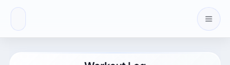 | 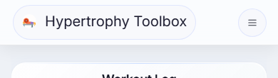 |
| Populated phone Log | 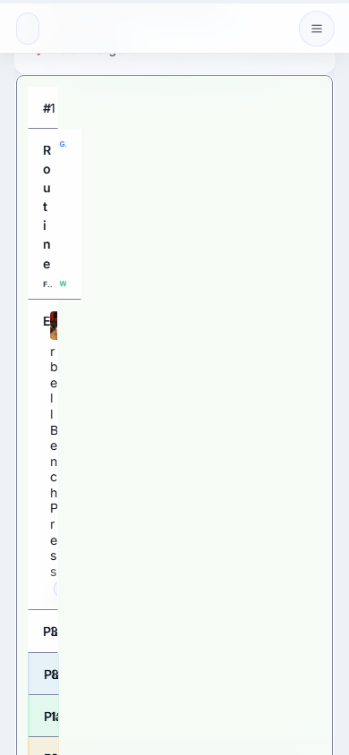 | 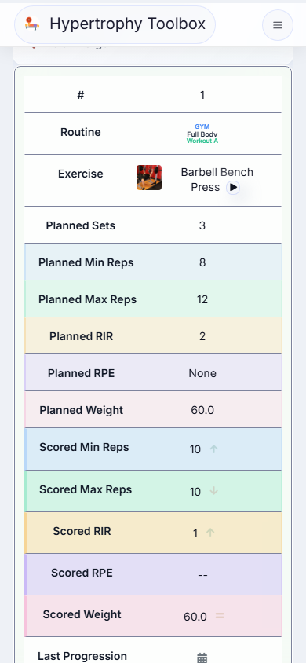 |
| Phone menu open in dark mode | 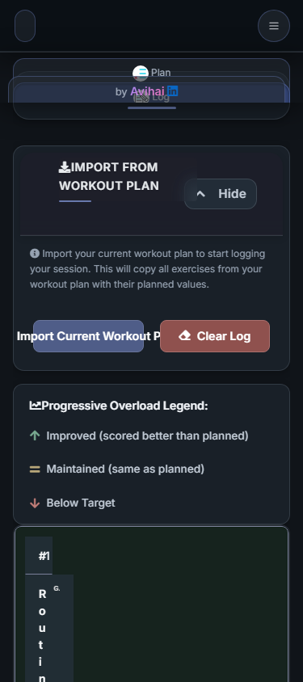 | 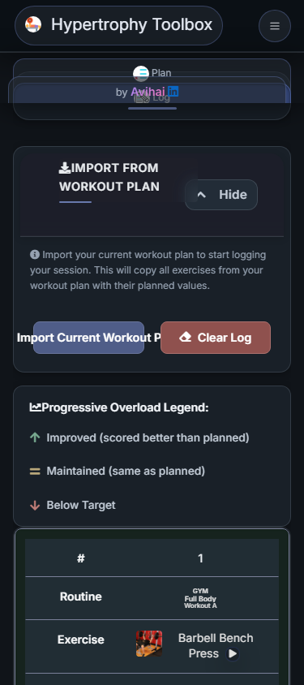 |
| Dark Backup form | 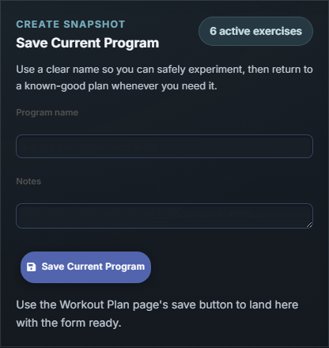 | 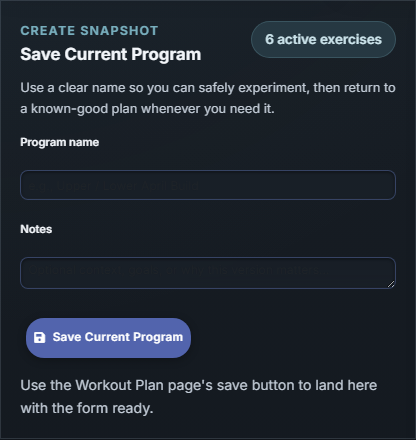 |
| Volume Splitter in light mode | 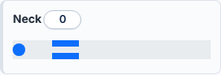 | 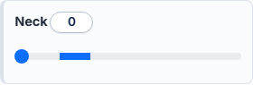 |
| Volume Splitter in dark mode | 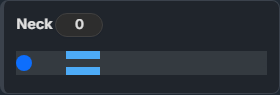 | 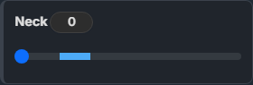 |
| Profile information icon |  |  |
| Body Composition save icon |  |  |

At 1440px the theme button's right edge moved from x = 1449 to x = 1424. At 390px the first exercise cell grew from 34px to 328px and the 17-field row shrank from 1318px to 898px. The card redesign belongs to the Workout Log pilot. The open-menu images reproduce the 62px panel clipping 291px of content on both builds. [Phone menu follow-up](https://github.com/AvihaiShai/Hypertrophy-Toolbox-v3/issues/733)

The dark Backup labels went from about 2.25:1 to 15.5:1. The ratio uses computed text color and the screenshot background sampled beside each label on its text midline. The slider images show a single 8px recommended band within a 24px-high native input. The screenshot comparisons complement the platform visual baselines. [Design decisions](https://github.com/AvihaiShai/Hypertrophy-Toolbox-v3/issues/736#issuecomment-6995960502)
